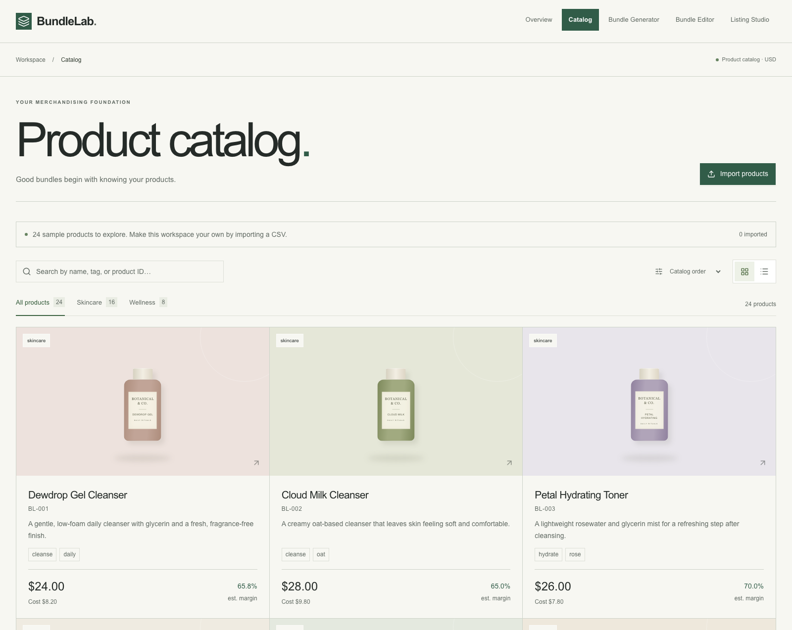
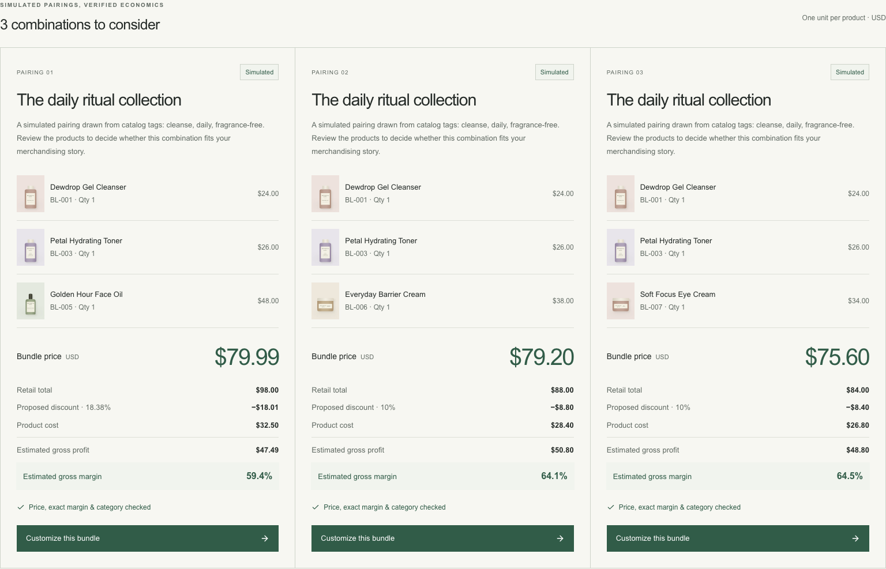
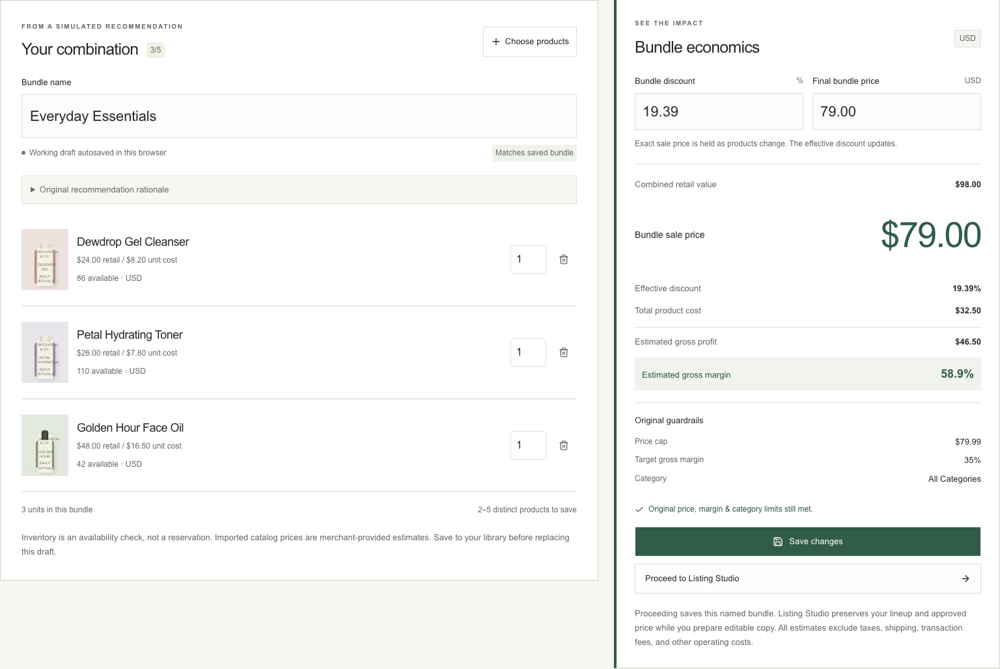
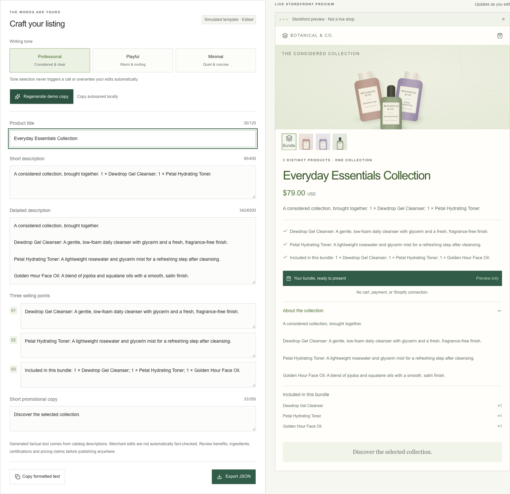

# BundleLab

Thoughtful product bundles, transparent economics, and listing copy in one merchant workflow.

BundleLab is a portfolio MVP exploring how small e-commerce merchants can move from a product catalog to a considered bundle and an editable listing. It combines real server-side AI with deterministic financial validation. A clearly labeled, key-free Demo Mode makes the entire workflow reviewable without paid services.

**Status:** MVP v1.0.0 · Editorial interface finalized · deployment pending.

**Repository:** [rowelsabahat/BundleLab](https://github.com/rowelsabahat/BundleLab) · public

**Live demo:** Pending deployment — replace with the verified Vercel URL.

**License:** [MIT](LICENSE). No customer research, production usage or revenue impact is claimed.

## The problem

Choosing complementary products, pricing a discount and writing a listing often require separate decisions and tools. BundleLab tests a compact workflow that keeps catalog context and estimated economics visible while merchants make those decisions. The target persona is a small-shop owner managing merchandising themselves; this is a product hypothesis, not a validated research finding.

## Implemented features

- **Overview and Catalog:** meaningful catalog summaries, 24 sample products, search, category filters, grid/list views, product details and a downloadable CSV template. Validated imports persist locally with row errors and stale-tab protection.
- **Bundle Generator:** prompt and optional price/margin/category/theme controls; up to three distinct suggestions with rationale, discount and independently calculated economics. Exact constraints, product IDs and stock are validated. Infeasible requests and AI failures are explained honestly.
- **Bundle Editor:** add/remove products, quantities, 0–50% discounts or direct cent-exact pricing, immediate estimates and target warnings. Save, reopen, rename, duplicate and delete multiple named bundles.
- **Listing Studio:** Professional, Playful and Minimal tones; grounded generation, editable title/descriptions/three selling points/promotional copy, live storefront preview, clipboard and downloadable JSON. Approved products and pricing remain unchanged.
- **Resilient workflow:** versioned browser-local storage, explicit recovery/error states, responsive navigation, focus-managed dialogs and a consistent Editorial design across every page.

## Screenshots

Actual production-build Demo captures, not mockups or live AI responses. [Captions and reproduction details](docs/screenshots/README.md).

### Catalog



### Bundle recommendations



### Bundle Editor



### Listing Studio



## Technology and architecture

Next.js 16.4.3 App Router, React 19.3, strict TypeScript, Tailwind CSS 4, Radix/shadcn-style primitives, Lucide icons and Zod. Vitest covers pure functions and API boundaries; Playwright covers desktop/mobile Chromium. npm and Node 24 are required; `package-lock.json` pins resolved dependencies.

Local JSON supplies the canonical catalog. Client components own interactive state and validated localStorage adapters. Server-only Next.js routes call OpenAI's Responses API using bounded native Fetch requests and structured output. The model selects known IDs/facts; TypeScript validates candidates and calculates all authoritative money using integer cents. Listing AI curates verified fact references and approved styles rather than inventing unconstrained claims. See [architecture](docs/ARCHITECTURE.md) for schemas, rounding and trust boundaries.

## Run locally

```bash
# In the project directory, with Node 24 installed
npm ci
cp .env.example .env.local
npm run dev
```

Open [http://localhost:3000](http://localhost:3000). The development/build scripts intentionally use Webpack; no database, account or Shopify setup is needed. Local data belongs to the current browser and origin.

### Environment and modes

`.env.example` documents all server-side settings:

- `BUNDLELAB_MODE`: `demo` by default. Use `ai` explicitly for real model calls; unsupported values block generation.
- `OPENAI_API_KEY`: required only for AI Mode. Set it in gitignored `.env.local` or secure hosting settings. Never use `NEXT_PUBLIC_` for a key.
- `OPENAI_MODEL`: optional; defaults to `gpt-4.1-mini`. Overrides must support the structured output used by this application.

Demo Mode deterministically uses the sample catalog, the same hard constraints and financial functions, and clearly labels simulated recommendations/templates. It never calls OpenAI. AI Mode makes real calls, reports missing credentials/quota/timeouts safely, and **never silently substitutes Demo results**. Restart development after changing local configuration; redeploy after changing hosted environment settings.

## Demo the complete workflow

1. Browse Catalog, inspect a product, search/filter and optionally import the downloadable CSV template with unique IDs.
2. Open Generator. Confirm Demo Mode, then request: **Create a starter kit under $80 with at least a 35% gross margin.** Compare the validated cards.
3. Customize a suggestion. Change a quantity, discount and exact sale price; inspect target warnings. Name/save the bundle, then duplicate/reopen it to explore the local library.
4. Proceed to Listing Studio. Generate demo copy, change a tone without losing edits, edit every field and inspect the live preview. Copy text or export JSON, then refresh to verify persistence.

For real AI, configure AI Mode and a funded key, restart, confirm the visible AI label and repeat steps 2–4. Automated tests mock external AI; they do not establish your account allowance or live output quality.

## Testing

```bash
npm run lint
npm run typecheck
npm test
npm run build
npm run format:check
npx playwright install chromium
npm run test:e2e
```

`npm run check` combines lint, typecheck, unit tests and production build. Browser tests build/start an isolated production Demo server on port 3100, explicitly clear the API key and use isolated browser contexts. They do not modify your development browser's saved data. GitHub Actions runs formatting, the combined checks and the complete Chromium suite on pushes/pull requests, with failure artifacts. See [QA.md](docs/QA.md) for actual executed results and manual checks; a configured workflow does not imply a successful remote run.

For a local production preview, run `npm run build` followed by `npm start`.

## Deployment

Use Vercel's Next.js preset, repository root, Node 24, `npm ci` and `npm run build`, with automatic output settings. No environment variables are needed for default Demo behavior; explicitly setting `BUNDLELAB_MODE=demo` is recommended. AI additionally needs a server-only key and optional model override. Follow [the GitHub/Vercel guide](docs/DEPLOYMENT.md). Deployment and remote project-setting changes require owner approval; no successful deployment URL is claimed here.

## Known limitations

- Portfolio prototype: no Shopify publishing/integration, authentication, payments, external database, cloud sync or real store analytics.
- One USD currency; financial estimates exclude tax, shipping, payment fees, overhead and returns. Gross margin is undefined for zero revenue, and losses remain visible.
- The sample dataset and import category enum cover skincare/wellness, although product positioning addresses merchants across categories. Server recommendations use the 24 seed products; validated imports work in the Editor/Studio.
- Storage is browser-local, not a backup. Stale-tab guards are best-effort and do not provide transactional multi-user synchronization.
- AI limits are instance-local, not distributed abuse protection or a global spending cap. A public paid AI deployment needs hosting controls and provider budget management. Merchant-edited copy still needs review.
- Chromium automation does not prove Safari/Firefox, real touch hardware or full accessibility conformance. Live provider behavior and deployed hosting require separate verification.

## Project documentation

- [Product requirements](docs/PRD.md)
- [Architecture and calculation boundaries](docs/ARCHITECTURE.md)
- [Design system](docs/DESIGN.md)
- [Decision log](docs/DECISIONS.md)
- [QA evidence and manual checklist](docs/QA.md)
- [Deployment instructions](docs/DEPLOYMENT.md)
- [MVP v1.0.0 release notes](CHANGELOG.md)
- [Persistent engineering instructions](AGENTS.md)
